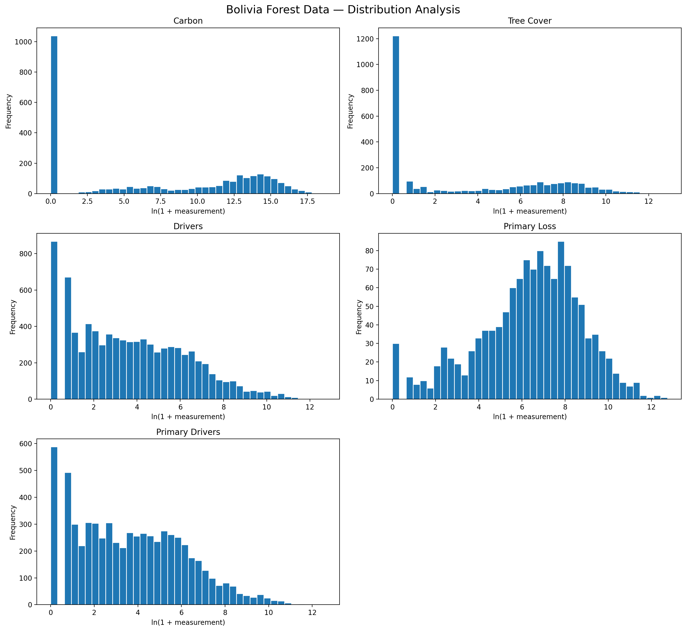
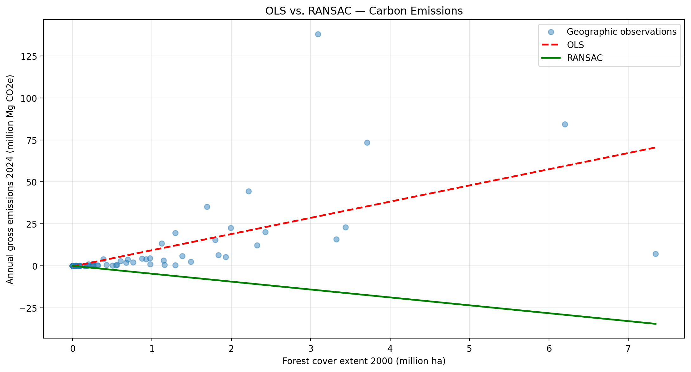
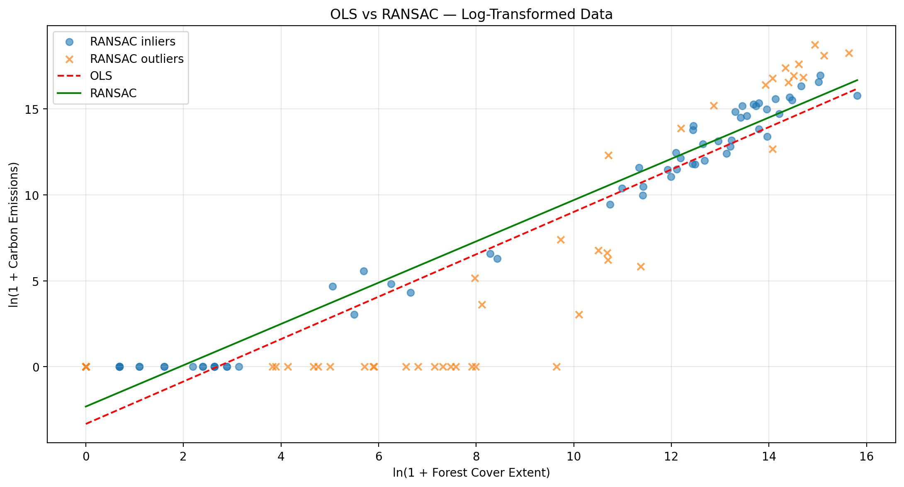

# Bolivia Forest Data Quality & Reconciliation

### End-to-End Data Quality, Multi-Source Integration & Exploratory Analysis with Python

A reproducible Python project focused on **data quality auditing, multi-source integration, anomaly detection, statistical analysis, and data reconciliation**, using environmental datasets from Bolivia covering 2001–2025.

The project demonstrates how multiple datasets with different geographic, temporal, and measurement coverage can be transformed into a consistent analytical structure without introducing unsupported corrections.

**Technologies:** Python · pandas · NumPy · Matplotlib · scikit-learn · Google Colab · unittest

---

## Table of Contents

1. [Project Overview](#1-project-overview)
2. [Dataset Overview](#2-dataset-overview)
3. [Data Quality Workflow](#3-data-quality-workflow)
4. [Before vs. After Integration](#4-before-vs-after-integration)
5. [Exploratory Data Analysis](#5-exploratory-data-analysis)
6. [Data Reconciliation Results](#6-data-reconciliation-results)
7. [Validation & Reproducibility](#8-validation--reproducibility)
8. [Technical Documentation](#11-technical-documentation)
9. [Project Limitations](#12-project-limitations)
10. [Professional Skills Demonstrated](#14-professional-skills-demonstrated)

---

## 1. Project Overview

### The Challenge

Environmental data is often distributed across multiple sources with different structures, geographic coverage, temporal ranges, and measurement definitions.

This project analyzes five forest-related datasets from **Global Nature Watch**, covering tree cover loss, primary forest loss, carbon measurements, and attributed drivers of forest loss in Bolivia.

The main challenge was not simply removing missing values or duplicate rows. Instead, it involved:

- Understanding the structure and granularity of each dataset.
- Identifying differences in geographic and temporal coverage.
- Validating composite keys before joining datasets.
- Integrating measurements without introducing misleading values.
- Investigating numerical discrepancies between related sources.
- Detecting statistical outliers without automatically treating them as errors.
- Building a reproducible Python integration pipeline.

### Project Objectives

1. Audit the quality of five original datasets.
2. Validate data types, uniqueness, geographic coverage, and temporal consistency.
3. Integrate related datasets using validated composite keys.
4. Analyze numerical discrepancies between forest loss measurements.
5. Identify potential statistical outliers using IQR and robust regression.
6. Produce a validated analytical dataset and reproducible documentation.

---

## 2. Dataset Overview

**Data source:** [Global Nature Watch — Bolivia](https://globalnaturewatch.org/dashboards/country/BOL/)

**Geographic scope:** Bolivia, Subnational Level 2

**Period:** 2001–2025, depending on the dataset

| Original Dataset | Records | Columns |
|---|---:|---:|
| Carbon Data | 8,400 | 12 |
| Tree Cover Loss | 22,400 | 9 |
| Drivers | 8,351 | 7 |
| Primary Forest Drivers | 6,506 | 7 |
| Primary Forest Loss | 1,296 | 6 |
| **Total** | **46,953** | |

The original CSV files contained no missing cells or exact duplicate rows.

However, the initial analysis identified structural differences in data availability, geographic coverage, temporal ranges, and canopy density thresholds.

These differences required a controlled integration strategy.

---

## 3. Data Quality Workflow

The project follows a structured process:

**Original Data → Data Profiling → Quality Validation → Multi-Source Integration → Reconciliation → Anomaly Detection → Analytical Dataset**

### Step 1 — Data Profiling

The five datasets were examined for:

- Missing values.
- Exact duplicate rows.
- Composite key duplicates.
- Data types and expected domains.
- Geographic coverage.
- Temporal coverage.
- Tree canopy density thresholds.

### Step 2 — Structural Validation

Validation rules were implemented to identify inconsistencies in forest cover measurements, geographic keys, supported years, and source availability.

### Step 3 — Multi-Source Integration

The datasets were integrated using the composite key:

```text
country + subnational1 + subnational2 + threshold + year
```

Driver-related observations were aggregated before integration to prevent unintended row multiplication.

A **30% canopy density threshold** was selected because it is available across all five sources.

The integration preserves the Tree Cover Loss observations as the base dataset and uses source availability indicators to distinguish matched and unmatched measurements.

### Step 4 — Cross-Dataset Reconciliation

Tree Cover Loss measurements were compared against the sum of losses attributed to individual drivers.

Numerical differences were calculated and documented without automatically modifying either source.

### Step 5 — Statistical Anomaly Detection

The Interquartile Range (IQR) method was used to identify potentially extreme observations.

OLS and RANSAC regression were also compared to explore the sensitivity of statistical relationships to unusual observations.

Statistical outliers were retained because they were not independently confirmed as measurement errors.

### Step 6 — Automated Validation

The integration process was extracted into a reusable Python module and tested using automated validation checks.

---

## 4. Before vs. After Integration


### Before

Five independent datasets containing **46,953 source records**, with different levels of geographic and temporal coverage.

### After

A validated analytical dataset containing:

| Metric | Result |
|---|---:|
| Integrated observations | 2,800 |
| Columns | 23 |
| Carbon matching coverage | 100.00% |
| Drivers matching coverage | 58.43% |
| Primary Forest Loss coverage | 46.29% |
| Primary Forest Drivers coverage | 45.43% |
| Structural missing cells after integration | 4,196 |

**Important:** The 4,196 missing cells were introduced by unmatched source observations during integration.

They represent differences in source coverage rather than confirmed data errors.

Similarly, the reduction from 46,953 original source records to 2,800 integrated observations does not represent the removal of incorrect records. The original datasets have different granularities, and the integrated dataset is restricted to the 30% canopy threshold.

All original source files were preserved.

---

## 5. Exploratory Data Analysis

### 5.1. Distribution Analysis



Distribution plots were generated for all five original datasets using logarithmic transformations for visualization.

The analysis revealed highly skewed distributions and large concentrations of zero-valued measurements in certain variables.

These patterns were investigated rather than automatically classified as errors.

### 5.2. Statistical Outlier Detection

Potential outliers were identified using the Interquartile Range method.

| Dataset | Potential Outliers | Percentage |
|---|---:|---:|
| Carbon | 476 | 17.00% |
| Tree Cover Loss | 473 | 16.89% |
| Drivers | 1,298 | 15.54% |
| Primary Forest Drivers | 944 | 14.51% |
| Primary Forest Loss | 165 | 12.73% |

**Decision:** Preserve the observations and document the statistical findings. These percentages do not represent percentages of incorrect data.

### 5.3. OLS vs. RANSAC Regression

#### Initial Regression Sensitivity



The initial comparison revealed substantial sensitivity to extreme observations and RANSAC parameter selection.

#### Log-Transformed Regression



A second analysis applied logarithmic transformations to forest cover extent and annual carbon emissions.

Both OLS and RANSAC were used to explore the relationship between the variables using observations from 2024 at a 30% canopy density threshold.

The regression comparison is exploratory. It does not establish causality, and RANSAC outlier classifications do not indicate confirmed errors.

### 5.4. Temporal Analysis


Annual measurements were analyzed to investigate patterns in forest cover loss and gross carbon emissions.

The highest recorded annual values in the analyzed data occurred in **2024**.

Variables representing long-term averages or reference-year measurements were excluded from annual summation.

### 5.5. Forest Loss Drivers


Forest loss was analyzed by attributed driver category for the common period 2002–2025.

| Driver | General Tree Cover Loss | Primary Forest Loss |
|---|---:|---:|
| Permanent agriculture | 55.00% | 48.14% |
| Wildfire | 37.96% | 45.05% |
| Other natural disturbances | 4.23% | 3.96% |
| Other categories | 2.81% | 2.85% |

Permanent agriculture and wildfires represented the largest attributed loss categories in both datasets.

These percentages are calculated within each source and should not be interpreted as directly comparable estimates for all forests in Bolivia because geographic coverage differs.

---

## 6. Data Reconciliation Results

### Tree Cover Loss vs. Drivers

| Metric | Result |
|---|---:|
| Matched observations | 1,636 |
| Exact numerical matches | 204 |
| Numerical discrepancies | 1,432 |
| Net relative difference | -0.23% |
| Absolute reconciliation gap | 0.23% |

### Primary Forest Loss vs. Primary Forest Drivers

| Metric | Result |
|---|---:|
| Matched observations | 1,272 |
| Exact numerical matches | 157 |
| Numerical discrepancies | 1,115 |
| Net relative difference | -0.1796% |
| Absolute reconciliation gap | 0.1802% |

**Key finding:** Related measurements do not always produce identical numerical totals.

The differences were documented rather than artificially reconciled.

Reconciliation metrics describe numerical agreement between selected matched observations. They are not measures of overall data quality or scientific accuracy.

---

## 7. Data Quality Decisions

| Finding | Action Taken |
|---|---|
| Different temporal coverage | Preserved unavailable observations as null |
| Different geographic coverage | Used validated joins and availability flags |
| Different canopy density thresholds | Selected threshold 30 for integration |
| Statistical outliers | Identified and retained |
| Numerical discrepancies | Documented without modifying measurements |
| Driver-level observations | Aggregated for integration while retaining original detail |
| Potential row multiplication | Prevented using composite key validation |

**No unsupported imputation, automatic outlier removal, or numerical adjustment was performed.**

---

## 8. Validation & Reproducibility

| Validation | Result |
|---|---|
| Structural integration checks | 10/10 passed |
| Final dataset checks | 6/6 passed |
| Automated integration tests | 5 passed |
| Integration reproducibility | Passed |
| Original Tree Cover values preserved | Passed |

The integration pipeline was implemented as a reusable Python module.

This separation allows the processing logic to be reused independently of the exploratory notebook.

---

## 9. Project Structure

```text
bolivia-deforestation-data-quality/
│
├── notebooks/
│   └── bolivia_data_quality_eda_v2.ipynb
│
├── src/
│   └── integration.py
│
├── tests/
│   └── test_integration.py
│
├── reports/
│   ├── CASE_STUDY.md
│   ├── DATA_QUALITY_REPORT_V2.md
│   └── ... additional audit reports
│
├── figures/
│   ├── 01_distribution_analysis.png
│   ├── 02_ols_vs_ransac.png
│   ├── 03_annual_trends.png
│   ├── 04_robust_regression_log.png
│   ├── 05_forest_loss_drivers.png
│   └── 06_before_after_integration.png
│
├── data/
│   └── raw/
│       └── README.md
│
├── requirements.txt
├── .gitignore
└── README.md
```

---

## 10. Installation & Reproducibility

### Requirements

- Python
- pandas
- NumPy
- Matplotlib
- scikit-learn

Install the project dependencies:

```bash
pip install -r requirements.txt
```

### Obtain the Data

Download the corresponding original Bolivia datasets from [Global Nature Watch](https://globalnaturewatch.org/dashboards/country/BOL/).

The following five CSV files are required:

```text
BOL - Subnational 2 carbon data.csv
BOL - Subnational 2 tree cover loss.csv
BOL - Subnational 2 drivers.csv
BOL - Subnational 2 primary drivers.csv
BOL - Subnational 2 primary loss.csv
```

Place them inside:

```text
data/raw/
```

The original source files are not included in this repository. Reproduction requires source files with the same schema and compatible data release.

### Run the Integration Pipeline

```python
from pathlib import Path
from src.integration import build_dataset

df = build_dataset(Path("data/raw"))

print(df.shape)
```

Expected dimensions for the project dataset release:

```text
(2800, 23)
```

### Run Automated Tests

From the project root:

```bash
python -m unittest discover -s tests -v
```

### Explore the Notebook

The documented analysis is available at:

[Open the Data Quality & EDA Notebook](notebooks/bolivia_data_quality_eda_v2.ipynb)

The notebook was originally developed in Google Colab and may require adapting its Google Drive paths to a different environment.

---

## 11. Technical Documentation

For detailed methodological explanations, processing decisions and validation results:

- [Full Project Case Study](reports/CASE_STUDY.md)
- [Data Quality Report V2](reports/DATA_QUALITY_REPORT_V2.md)
- [Before vs. After Quality Assessment](reports/before_after_quality_v2.csv)
- [Outlier Audit](reports/outlier_audit_v2.csv)
- [Integration Validation](reports/integration_validation_v2.csv)
- [Source Coverage Report](reports/source_coverage_v2.csv)

---

## 12. Project Limitations

- Original source coverage differs across geographic units and time periods.
- The integrated dataset is restricted to a 30% canopy density threshold.
- Statistical outliers are not necessarily measurement errors.
- Reconciliation differences remain subject to methodological investigation.
- Tree cover loss does not always indicate permanent deforestation.
- Regression analyses are exploratory and do not establish causal relationships.
- The original source measurements have not been independently verified.

---

## 13. Data Attribution

**Source:** Global Nature Watch / World Resources Institute

[Global Nature Watch — Bolivia Dashboard](https://globalnaturewatch.org/dashboards/country/BOL/)

Original datasets are excluded from this repository pending verification of dataset-specific redistribution conditions.

Users should consult the original provider's documentation, methodology and applicable licensing requirements.

---

## 14. Professional Skills Demonstrated

This project demonstrates practical capabilities in:

- Data Cleaning & Preparation
- Data Quality Assessment
- Data Profiling & Validation
- Multi-Source Data Integration
- Data Reconciliation
- Exploratory Data Analysis (EDA)
- Statistical Anomaly Detection
- Python Automation
- Reproducible Data Pipelines
- Automated Testing
- Technical Documentation

**Portfolio focus:** Building reliable analytical datasets from multiple sources while preserving data integrity, documenting limitations and producing reproducible results.
