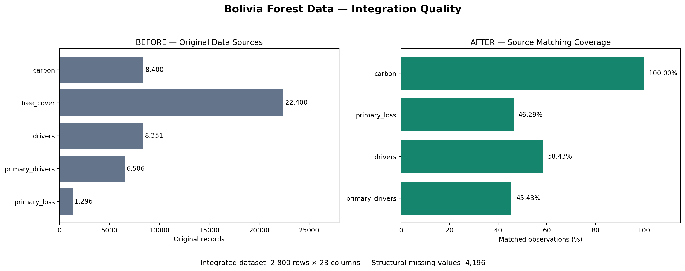
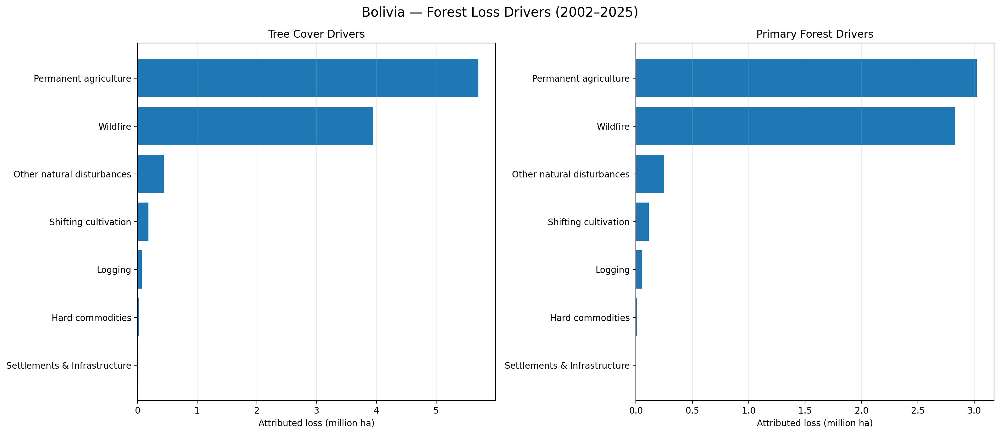
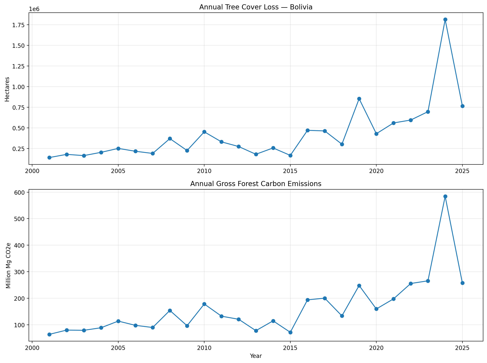

# Bolivia Forest Data Quality & Reconciliation

**Python · pandas · Data Quality · Multi-Source Integration · EDA · Automated Testing**

A portfolio case study showing how **five environmental datasets from Bolivia (2001–2025)** were audited, reconciled, and integrated into a traceable analytical dataset. The focus is on **reliable data preparation**, not on artificially changing measurements to make them agree.

[**Explore the case study**](reports/CASE_STUDY.md) · [**Read the data quality report**](reports/DATA_QUALITY_REPORT_V2.md) · [**Open the notebook**](notebooks/bolivia_data_quality_eda_v2.ipynb)

## At a Glance

| Measure | Verified result |
|---|---:|
| Original data sources | 5 CSV files |
| Rows across original sources | 46,953 |
| Integrated analytical dataset | **2,800 rows × 23 columns** |
| Structural integration checks | **10/10 passed** |
| Final checks / automated tests | **6/6 passed · 5 tests passed** |
| Tree Cover–Drivers matching coverage | 58.43% |

> **Important:** The 46,953 source rows and 2,800 integrated rows have different granularities. This is **not** a reduction of erroneous records. Original source files and measurements were preserved.

## Contents

- [The Challenge & Business Value](#the-challenge--business-value)
- [Before vs. After](#before-vs-after)
- [Methodology](#methodology)
- [Key Findings](#key-findings)
- [Reproduce the Project](#reproduce-the-project)
- [Documentation & Limitations](#documentation--limitations)

## The Challenge & Business Value

Real-world data is often distributed across separate tables that do not align perfectly. Here, the five [Global Nature Watch Bolivia](https://globalnaturewatch.org/dashboards/country/BOL/) datasets describe **tree cover loss, primary forest loss, carbon, and attributed drivers of forest loss** at subnational level 2.

The original CSVs contained **no missing cells and no exact duplicate rows**. The actual challenges were different temporal coverage (2001–2025 versus 2002–2025), different geographic coverage, different canopy thresholds, and non-identical measurements across related sources.

This is similar to a common client problem: **combining inconsistent data extracts into one reliable dataset while explaining why some values cannot be matched**. The deliverables demonstrate profiling, validated joins, reconciliation, automated checks, and transparent decisions.

## Before vs. After



**Before:** Five separate CSVs, with 46,953 total source rows and different measurement granularities.

**After:** One analytical table with **2,800 observations and 23 columns** at the **30% canopy-density threshold**, with explicit source-availability flags and validated composite keys.

| Source matched to integrated rows | Coverage |
|---|---:|
| Carbon Data | 100.00% |
| Drivers | 58.43% |
| Primary Forest Loss | 46.29% |
| Primary Forest Drivers | 45.43% |

The integration contains **4,196 missing measurement cells** caused by unmatched source records. They represent documented coverage gaps, **not newly introduced errors**. We did not fill them with zero or inferred values.

## Methodology

1. **Profile** all five CSVs: nulls, exact duplicates, data types, year ranges, geographic coverage, and canopy thresholds.
2. **Validate** composite-key uniqueness and numerical consistency rules.
3. **Aggregate** driver-attributed observations before joining, avoiding unintended row multiplication.
4. **Integrate** at a common 30% canopy threshold using `country`, `subnational1`, `subnational2`, `threshold`, and `year`.
5. **Reconcile** reported tree cover loss with the sum of driver-attributed loss; keep unmatched records visible.
6. **Explore** distributions, IQR-flagged outliers, time series, and OLS-versus-RANSAC regression sensitivity.
7. **Automate** the integration in `src/integration.py` and validate it with `unittest`.

**Processing policy:** Preserve original measurements; do not automatically remove statistical outliers, impute structurally unavailable observations, or force totals to match.

## Key Findings

### 1. Reconciliation detects discrepancies, not necessarily errors

| Matched-source comparison | Numerical discrepancies | Net relative gap |
|---|---:|---:|
| Tree Cover Loss vs. Drivers (1,636 matched rows) | 1,432 | −0.23% |
| Primary Forest Loss vs. Primary Drivers (1,272 matched rows) | 1,115 | −0.1796% |

The **absolute** reconciliation gap was **0.23%** for Tree Cover–Drivers and **0.1802%** for primary forest comparisons. These are measures of numerical disagreement among **matched** observations, **not data-quality or accuracy scores**. The underlying values remain unchanged.

### 2. Permanent agriculture and wildfire dominate attributed losses



In the **general tree cover driver** data, permanent agriculture accounts for **55.00%** of attributed loss and wildfire for **37.96%**. In the **primary forest driver** data, the respective shares are **48.14%** and **45.05%**. These percentages have **different geographic coverage and denominators**, so they are descriptive within each source rather than directly comparable national estimates.

### 3. Annual trends show a pronounced 2024 peak



Within the analyzed source records, **2024** had the highest annual tree cover loss and gross forest carbon emissions. The series uses annual variables; static reference measurements and long-period averages were not added across years.

### 4. Potential outliers were investigated, not deleted

The IQR method flagged **12.73%–17.00%** of observations across the five sources at the selected 30% canopy threshold. These are **statistical flags**, not proven errors. The additional [distribution plots](figures/01_distribution_analysis.png), [initial regression comparison](figures/02_ols_vs_ransac.png), and [log-transformed OLS–RANSAC analysis](figures/04_robust_regression_log.png) document sensitivity to extreme values and model settings, without claiming causality.

## Reproduce the Project

The source CSVs are **not redistributed** in this repository pending confirmation of dataset-specific permissions.

1. Download the matching Bolivia **Subnational 2** CSVs from [Global Nature Watch](https://globalnaturewatch.org/dashboards/country/BOL/):
   - `BOL - Subnational 2 carbon data.csv`
   - `BOL - Subnational 2 tree cover loss.csv`
   - `BOL - Subnational 2 drivers.csv`
   - `BOL - Subnational 2 primary drivers.csv`
   - `BOL - Subnational 2 primary loss.csv`
2. Place all five files under `data/raw/`.
3. From the repository root, install dependencies and run tests:

```bash
git clone https://github.com/MickyMatheus/bolivia-deforestation-data-quality.git
cd bolivia-deforestation-data-quality
pip install -r requirements.txt
python -m unittest discover -s tests -v
```

Run the integration from Python:

```python
from pathlib import Path
from src.integration import build_dataset

df = build_dataset(Path("data/raw"))
print(df.shape)  # (2800, 23) for the source release used in this case study
```

The [Colab notebook](notebooks/bolivia_data_quality_eda_v2.ipynb) contains the exploratory workflow; **local Google Drive paths may need adaptation**. Tests assert the original project's record counts, so results can differ if the source provider changes its data release.

## Documentation & Limitations

- [**Full case study** — problem, decisions, findings, deliverables](reports/CASE_STUDY.md)
- [**Data quality report** — validation and reconciliation](reports/DATA_QUALITY_REPORT_V2.md)
- [**Before/after audit table**](reports/before_after_quality_v2.csv) · [**Outlier summary**](reports/outlier_audit_v2.csv) · [**Source coverage**](reports/source_coverage_v2.csv)
- [**Python integration module**](src/integration.py) · [**Automated tests**](tests/test_integration.py)

**Limitations:** Coverage varies across sources; this integrated dataset uses only the 30% canopy threshold. Tree cover loss is not equivalent to permanent deforestation. Driver classifications and carbon measurements have not been independently ground-truthed. Regression findings are exploratory, and reconciliation differences do not establish which source is more accurate.

**Source attribution:** [Global Nature Watch / World Resources Institute — Bolivia](https://globalnaturewatch.org/dashboards/country/BOL/). Check dataset-specific methodology and redistribution conditions before sharing source files.

---

**Skills demonstrated:** Data Profiling · Data Quality · Data Integration · Reconciliation · Python / pandas · EDA · Statistical Anomaly Detection · Automated Tests · Reproducible Reporting
